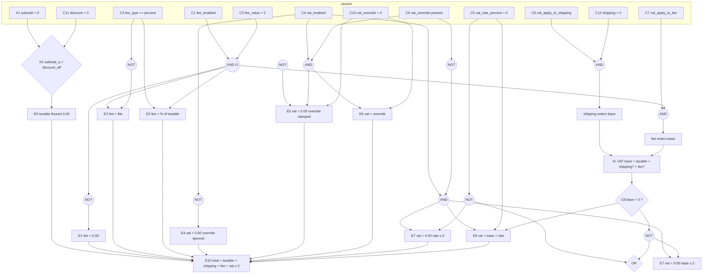

# CEG — Cause–Effect Graph and Decision Table for the `pricing` module

Technique: **cause–effect graphing** (Elmendorf/Goodenough–Gerhart style):
causes (input conditions) → boolean graph (AND/OR/NOT gates + intermediate
nodes) → effects (observable output conditions); the graph is flattened into a
**restricted-entry decision table** (don't-care = `—`); impossible cause
combinations are **struck out**; every feasible column becomes exactly one
test in [`../tests/test_ceg.py`](../tests/test_ceg.py).

Derivation source: `SPEC.md` §9 (CEG anchor), §5 (F1–F5 fee rules), §6
(V1–V5 VAT rules), §7 (T1–T8 totals composition). The module under test is
`tss/lab/pricing.py` (`compute_fee` pricing.py:47, `compute_vat`
pricing.py:66, `compute_totals` pricing.py:91). All observation is done
through `compute_totals` because that is the only callable through which all
four target decision outcomes are jointly observable; the graph itself is
stated at the rule level so it also covers the `compute_fee`/`compute_vat`
sub-decisions embedded in it.

The four decision outcomes the task names, and where each lives:

| Decision outcome | Spec rules | Graph nodes |
|---|---|---|
| fee applied or 0 | F1–F5, T5 | C1,C2,C3 → I1 → E1–E3 |
| VAT base composition | V3, T6 (else-arm) | C6,C7,C12,I1 → I4 (base), C8 |
| VAT 0 vs override vs computed | V1,V2,V4,V5, T6 | C4,C5,C8,C9,C10 → E4–E8 |
| totals clamping | T1–T4, T7 | X1,C11 → I3 → E9; identity E10 |

---

## 1. Causes

Twelve causes are given verbatim by SPEC §9. Two derived sign conditions
(X1, X2) are added as *intermediate causes* because effect E9 (taxable
floored) depends on `subtotal_q < discount_eff`, not on C11 alone (a positive
discount smaller than the subtotal does **not** floor the taxable amount, and
a zero discount together with a negative subtotal **does** — see column 17).

| id | cause (condition on inputs) | values |
|---|---|---|
| C1 | `fee_enabled` | T / F |
| C2 | `fee_value > 0` | T / F |
| C3 | `fee_type == "percent"` | T / F (F covers `"flat"` and any other string, §3) |
| C4 | `vat_enabled` | T / F |
| C5 | `vat_rate_percent > 0` | T / F |
| C6 | `vat_apply_to_shipping` | T / F |
| C7 | `vat_apply_to_fee` | T / F |
| C8 | composed VAT `base > 0` (intermediate effect of I4) | T / F |
| C9 | `vat_override is not None` | T / F |
| C10 | `vat_override > 0` | T / F |
| C11 | `discount > 0` | T / F |
| C12 | `shipping > 0` | T / F |
| X1 | `subtotal < 0` (derived sign condition) | T / F |
| X2 | `subtotal_q < discount_eff` where `discount_eff = C11 ? discount_q : 0` (derived) | T / F |

## 2. Effects (observable outcomes)

| id | effect | formal definition |
|---|---|---|
| E1 | `fee == 0.00` | `¬I1` |
| E2 | fee = flat `fee_value` quantized | `I1 ∧ ¬C3` (F4) |
| E3 | fee = `taxable × fee_value / 100` quantized | `I1 ∧ C3` (F3; value is 0.00 when taxable = 0) |
| E4 | `vat == 0.00`, any override ignored | `¬C4` (T6 arm 1, V1) |
| E5 | `vat == 0.00`, override clamped | `C4 ∧ C9 ∧ ¬C10` (T6 arm 2, non-positive override) |
| E6 | vat = quantized override | `C4 ∧ C9 ∧ C10` (T6 arm 2, positive override; rate/flags ignored) |
| E7 | `vat == 0.00` from computed rules | `C4 ∧ ¬C9 ∧ (¬C5 ∨ ¬C8)` (V2 or V4) |
| E8 | vat = quantized `base × rate / 100` | `C4 ∧ ¬C9 ∧ C5 ∧ C8` (V5) |
| E9 | `taxable_subtotal == 0.00` (floored) | `X2` (T3) |
| E10 | total identity: `total = taxable + shipping + fee + vat`, `total ≥ 0` | holds in **every** column (T7) — asserted as an invariant in every test |

## 3. The cause–effect graph

### 3.1 Boolean equations (the graph, formally)

```
I1 (fee computation proceeds)      = C1 ∧ C2                          [F1, F2]
fee > 0                            = I1 ∧ (¬C3 ∨ taxable > 0)          [F3 on taxable=0 ⇒ 0]
I4 (VAT base)                      = taxable
                                     ⊕ (C6 ∧ C12 ? shipping_q : 0)     [V3, T4]
                                     ⊕ (C7 ∧ (fee > 0) ? fee : 0)      [V3, T5]
C8                                 = (I4 > 0)                          [V4 guard]
X2 (taxable floors)                = subtotal_q < (C11 ? discount_q : 0)[T2, T3]
                                     — fires for discount > subtotal (C11 ∧ X2)
                                     and for subtotal < 0 with no discount (X1 ∧ ¬C11)

E1  = ¬I1
E2  = I1 ∧ ¬C3
E3  = I1 ∧ C3
E4  = ¬C4                                 (C9, C10 inputs become don't-care)
E5  = C4 ∧ C9 ∧ ¬C10                      (C5, C6, C7, C8 become don't-care)
E6  = C4 ∧ C9 ∧ C10                       (C5, C6, C7, C8 become don't-care)
E7  = C4 ∧ ¬C9 ∧ (¬C5 ∨ ¬C8)
E8  = C4 ∧ ¬C9 ∧ C5 ∧ C8
E9  = X2
E10 = always (invariant)
```

### 3.2 Diagram



### 3.3 Constraints — impossible combinations (struck out)

Enumerating the raw cross-products per cluster and striking contradictions:

1. ~~`¬C9 ∧ C10`~~ — `vat_override > 0` cannot hold while `vat_override is
   None`. In the VAT-resolution cluster (C4, C9, C10, C5, C8) the raw
   2⁵ = 32 combinations shrink to 24; these **8 struck combinations get no
   tests**.
2. ~~`¬C4 ∧ (E5 ∨ E6 ∨ E7 ∨ E8)`~~ — SPEC §9's own example: with
   `vat_enabled` false the only possible VAT-output effect is `vat == 0.00`
   (E4); the override and rate causes may still be *supplied* as inputs but
   cannot produce any other effect.
3. ~~`C4 ∧ C9 ∧ (E7 ∨ E8)`~~ — a present override short-circuits the computed
   arm (T6 order), so rate/base causes cannot fire computed effects.
4. ~~`¬I1 ∧ (E2 ∨ E3)`~~ — a non-zero fee requires `fee_enabled` **and**
   `fee_value > 0` (F1, F2).
5. ~~`C7 ∧ ¬(fee > 0) ∧ "fee enters base"`~~ — `apply_to_fee` cannot add a
   positive fee contribution when the fee is 0 (column 9: flag set, fee 0 →
   base unchanged).
6. ~~`C6 ∧ ¬C12 ∧ "shipping enters base"`~~ — `apply_to_shipping` cannot add
   a positive shipping contribution when shipping ≤ 0, because T4 already
   zeroes the reported shipping (column 8).
7. ~~`compute_totals: base < 0`~~ — at the totals level every base summand is
   clamped ≥ 0 (T3/T4/F-rules), so C8 can only be false via `base == 0`
   (column 14); a strictly negative base is reachable **only** by calling
   `compute_vat` directly with a negative `shipping`, which is outside this
   table's observable interface.
8. ~~`¬X2 ∧ E9`~~ and ~~`X2 ∧ ¬E9`~~ — the floor effect and its cause are
   definitionally tied (T3); there is no independent path to a floored
   taxable amount.

Fee cluster note: the raw 2³ combinations of (C1, C2, C3) are **all
feasible** — nothing is struck there; they merge into 4 rules via don't-cares
(columns 1–4). Base-composition cluster (C6, C7, C12, fee>0): 2⁴ = 16 raw
combinations, all feasible, merged into the 4 composition patterns plus the
two "flag set but summand zero" patterns (columns 5–9).

---

## 4. Decision table

Restricted-entry table; one **row below = one column** of the abstract
decision table (transposed for readability). `—` = don't care. X2 is the
derived condition `subtotal_q < discount_eff` (see §1). Expected values are
exact `Decimal`s as asserted by the tests; every test additionally asserts
the E10 identity `total == taxable + shipping + fee + vat` and `total ≥ 0`.

Reference frame (causes not varied by a column take these values):
subtotal `100.00`, discount `0`, shipping `10.00`, flat fee `5.00`, VAT rate
`10`, apply flags T/T, no override, everything enabled.

| col | C1 | C2 | C3 | C4 | C5 | C6 | C7 | C8 | C9 | C10 | C11 | C12 | X1 | X2 | fee | vat | taxable | shp | total | test |
|----|----|----|----|----|----|----|----|----|----|----|----|----|----|----|----|----|----|----|----|----|
| 1  | T | T | F | T | T | T | T | T | F | — | F | T | F | F | 5.00 (E2) | 11.50 (E8) | 100.00 | 10.00 | 126.50 | `test_col_01_fee_flat_applied` |
| 2  | T | T | T | T | T | T | T | T | F | — | F | T | F | F | 7.00 (E3) | 11.70 (E8) | 100.00 | 10.00 | 128.70 | `test_col_02_fee_percent_applied` |
| 3  | F | T | — | T | T | T | T | T | F | — | F | T | F | F | 0.00 (E1) | 11.00 (E8) | 100.00 | 10.00 | 121.00 | `test_col_03_fee_zero_when_disabled` |
| 4  | T | F | — | T | T | T | T | T | F | — | F | T | F | F | 0.00 (E1) | 11.00 (E8) | 100.00 | 10.00 | 121.00 | `test_col_04_fee_zero_when_value_nonpositive` |
| 5  | T | T | F | T | T | F | F | T | F | — | F | T | F | F | 5.00 | 10.00 (base=taxable) | 100.00 | 10.00 | 125.00 | `test_col_05_vat_base_taxable_only` |
| 6  | T | T | F | T | T | T | F | T | F | — | F | T | F | F | 5.00 | 11.00 (base=+shp) | 100.00 | 10.00 | 126.00 | `test_col_06_vat_base_plus_shipping` |
| 7  | T | T | F | T | T | F | T | T | F | — | F | T | F | F | 5.00 | 10.50 (base=+fee) | 100.00 | 10.00 | 125.50 | `test_col_07_vat_base_plus_fee` |
| 8  | T | T | F | T | T | T | F | T | F | — | F | F | F | F | 5.00 | 10.00 (shp≤0 adds 0) | 100.00 | 0.00 | 115.00 | `test_col_08_shipping_flag_true_but_nonpositive_shipping_contributes_nothing` |
| 9  | T | F | — | T | T | F | T | T | F | — | F | T | F | F | 0.00 | 10.00 (fee=0 adds 0) | 100.00 | 10.00 | 120.00 | `test_col_09_fee_flag_true_but_zero_fee_contributes_nothing` |
| 10 | T | T | F | F | — | T | T | — | T | T | F | T | F | F | 5.00 | 0.00 (E4, override 99.99 ignored) | 100.00 | 10.00 | 115.00 | `test_col_10_vat_disabled_override_ignored` |
| 11 | T | T | F | T | — | T | T | — | T | T | F | T | F | F | 5.00 | 8.75 (E6, beats computed 11.50) | 100.00 | 10.00 | 123.75 | `test_col_11_vat_override_positive_wins` |
| 12 | T | T | F | T | — | T | T | — | T | F | F | T | F | F | 5.00 | 0.00 (E5, −8.75 clamped) | 100.00 | 10.00 | 115.00 | `test_col_12_vat_override_nonpositive_clamped` |
| 13 | T | T | F | T | F | T | T | T | F | — | F | T | F | F | 5.00 | 0.00 (E7 via V2, rate 0) | 100.00 | 10.00 | 115.00 | `test_col_13_vat_zero_when_rate_nonpositive` |
| 14 | T | T | T | T | T | T | T | F | F | — | T | F | F | T | 0.00 (E3 on taxable 0) | 0.00 (E7 via V4, base 0; E9) | 0.00 | 0.00 | 0.00 | `test_col_14_vat_zero_when_base_zero_and_taxable_floored` |
| 15 | T | T | F | T | T | T | T | T | F | — | F | T | F | F | 5.00 | 11.50 | 100.00 | 10.00 | 126.50 | `test_col_15_negative_discount_reports_zero` |
| 16 | T | T | F | T | T | T | T | T | F | — | T | T | F | F | 5.00 | 9.00 (base 90) | 75.00 | 10.00 | 99.00 | `test_col_16_positive_discount_below_subtotal_reduces_taxable` |
| 17 | T | T | F | T | T | T | T | T | F | — | F | T | T | T | 5.00 | 1.50 (base 15) | 0.00 (E9 via X1) | 10.00 | 16.50 | `test_col_17_negative_subtotal_reported_as_is_taxable_floored_total_nonnegative` |

Concrete input vectors (deviations from the reference frame only):

| col | deviations |
|---|---|
| 1 | none |
| 2 | `fee_type="percent"`, `fee_value=7` |
| 3 | `fee_enabled=False` |
| 4 | `fee_value=-3.00` |
| 5 | `vat_apply_to_shipping=False`, `vat_apply_to_fee=False` |
| 6 | `vat_apply_to_fee=False` |
| 7 | `vat_apply_to_shipping=False` |
| 8 | `shipping=-10.00` |
| 9 | `fee_value=0.00`, `vat_apply_to_shipping=False` |
| 10 | `vat_enabled=False`, `vat_override=99.99` |
| 11 | `vat_override=8.75` |
| 12 | `vat_override=-8.75` |
| 13 | `vat_rate_percent=0` |
| 14 | `discount=250.00`, `shipping=0.00`, `fee_type="percent"`, `fee_value=7` |
| 15 | `discount=-20.00` |
| 16 | `discount=25.00` |
| 17 | `subtotal=-50.00` |

Column provenance (which decision outcome each column exercises):

- **fee applied or 0**: columns 1–4 (E2/E3/E1 via ¬C1 / E1 via ¬C2).
- **VAT base composition**: columns 5–9 (neither / +shipping / +fee / flag
  set but shipping ≤ 0 adds nothing / flag set but fee 0 adds nothing;
  column 1 is the both-flags composition).
- **VAT 0 vs override vs computed**: columns 10 (E4), 11 (E6), 12 (E5),
  13 (E7-rate), 14 (E7-base); the computed arm E8 is represented by columns
  1, 2, 5–9, 15–17.
- **totals clamping**: columns 8 (shipping ≤ 0 → 0.00), 14 (discount ≥
  subtotal floors taxable; percent fee follows the floored taxable), 15
  (discount ≤ 0 reports 0.00), 16 (positive discount reduces taxable), 17
  (negative subtotal reported as-is yet total stays ≥ 0); E10 identity is
  asserted in **every** column.

## 5. Deliberately out of scope (owned by the other suites)

- Out-of-vocabulary `fee_type` / `rounding` strings and the four rounding
  modes' tie behaviour (§3, R2) — EP/BVA territory; this suite fixes
  `rounding="half_up"` and `fee_type ∈ {"flat","percent"}`.
- Sub-cent boundary values (`x.xx5`, 0.001-style) — BVA.
- Independent condition-pair flipping for the T6 three-way branch — MC/DC.
- Direct `compute_vat` with negative base (impossible at totals level,
  §3.3 item 7) — input-domain partitioning (EP).
