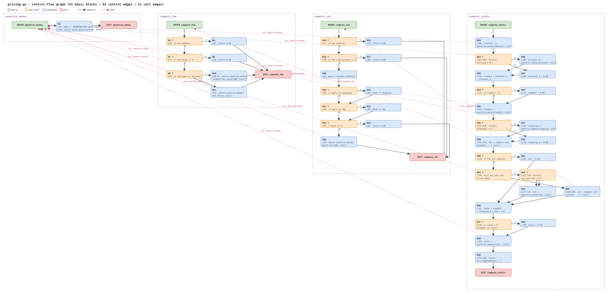

# Control-flow graph & cyclomatic complexity of `pricing.py` — Task 3

Task: *transform the pricing module into a directed graph* — build the CFG,
compute V(G) = E − N + 2P per function and for the module, and identify a
basis set of linearly independent paths covering **all** edges.

**Artifacts** (all in `tss/lab/docs/`):

| File | Content |
|---|---|
| [`cfg.drawio`](cfg.drawio) | the CFG as real draw.io XML (`mxfile > diagram > mxGraphModel > root > mxCell`), 51 numbered nodes `N1..N51` in four function bands, 62 solid control edges `E1..E62` (labeled `T`/`F` at decisions), 11 dashed call edges `C1..C11` to helper entries |
| [`cfg.svg`](cfg.svg) | the same graph rendered as a deterministic hand-written SVG (boxes + arrowed edges, banded per function, legend) so docs can embed an image |
| [`gen_cfg.py`](gen_cfg.py) | generator + verifier: emits both files from one graph data structure, then re-parses `cfg.drawio` and machine-checks every count and every basis path (receipts in §7) |

Module under analysis: [`tss/lab/pricing.py`](../pricing.py) — the four public
callables declared in [`SPEC.md` §1](../SPEC.md) and
[`README.md` "Scope declaration"](../README.md): `quantize_money` (L31–33),
`compute_fee` (L47–63), `compute_vat` (L66–88), `compute_totals` (L91–159).
`PricingBreakdown` (L36–44) is a frozen dataclass record, not a callable with
control flow, so it has no CFG nodes.



---

## 1. Construction rules

* **Node = basic block**: a maximal straight-line statement sequence — entered
  only at the top, left only at the bottom. Each function additionally gets an
  `ENTER` and an `EXIT` node (single-entry / single-exit flow graph, the
  standard precondition for V(G) = E − N + 2).
* **Decisions**: every `if`/`elif` condition is its own decision node with a
  `T` and an `F` out-edge. **Conditional (ternary) expressions count as
  decisions too** — `pricing.py` L107–109, L114–116 and L127–129 are genuine
  two-way branch points (they select between different computations, and
  `coverage.py --branch`, configured in `pyproject.toml` with `branch = true`,
  counts them as arcs). There are no loops, no `and`/`or` short-circuits, no
  `try`/`except` and no comprehensions in the module (verified by the AST
  walk in §7, check 2).
* **Call edges**: an interprocedural dashed edge from the basic block
  containing a call to a *module helper* (`quantize_money`, `compute_fee`,
  `compute_vat`) to that helper's ENTER node. Calls into the stdlib
  (`Decimal`, `dict.get`) and the `PricingBreakdown(...)` constructor call
  (L151) are not module helpers and get no call edges.
* **Call edges are excluded from V(G).** McCabe's metric is defined on
  single-entry single-exit flow graphs; a call transfers control and *returns*
  — it does not merge the flow graphs. Counting the 11 call edges as control
  edges would give E=73, N=51, P=1 → 24, a *call-graph-augmented* number that
  double-counts nothing structural about decisions and is not the McCabe
  module metric; the module value below is the standard Σ V(Gᵢ).

## 2. Node inventory (51 nodes)

Legend: **entry**/exit = function boundary, **decision** = branch condition,
stmt = straight-line block (calls to module helpers marked `[call]`).

### `quantize_money` — pricing.py L31–33 (3 nodes, N=3)

| Node | Kind | Statements (source lines) |
|---|---|---|
| N1 | entry | ENTER `quantize_money` |
| N2 | stmt | L32 `mode = _ROUNDING_MAP.get(str(rounding), ROUND_HALF_UP)`; L33 `return Decimal(value).quantize(MONEY_QUANT, rounding=mode)` |
| N3 | exit | EXIT |

(`dict.get` with a default has no branch at Python-statement level — V(G)=1,
confirmed by AST in §7.)

### `compute_fee` — pricing.py L47–63 (9 nodes)

| Node | Kind | Statements |
|---|---|---|
| N4 | entry | ENTER `compute_fee` |
| N5 | decision | L55 `if not enabled` |
| N6 | stmt | L56 `return Decimal("0.00")` |
| N7 | decision | L57 `if fee_value <= 0` |
| N8 | stmt | L58 `return Decimal("0.00")` |
| N9 | decision | L59 `if fee_type == "percent"` |
| N10 | stmt | L60–62 `return quantize_money(taxable_subtotal * fee_value / 100)` **[call]** |
| N11 | stmt | L63 `return quantize_money(fee_value)` **[call]** |
| N12 | exit | EXIT |

### `compute_vat` — pricing.py L66–88 (14 nodes)

| Node | Kind | Statements |
|---|---|---|
| N13 | entry | ENTER `compute_vat` |
| N14 | decision | L77 `if not enabled` |
| N15 | stmt | L78 `return Decimal("0.00")` |
| N16 | decision | L79 `if vat_rate_percent <= 0` |
| N17 | stmt | L80 `return Decimal("0.00")` |
| N18 | stmt | L81 `base = taxable_subtotal` |
| N19 | decision | L82 `if apply_to_shipping` |
| N20 | stmt | L83 `base += shipping` |
| N21 | decision | L84 `if apply_to_fee` |
| N22 | stmt | L85 `base += fee` |
| N23 | decision | L86 `if base <= 0` |
| N24 | stmt | L87 `return Decimal("0.00")` |
| N25 | stmt | L88 `return quantize_money(base * vat_rate_percent / 100)` **[call]** |
| N26 | exit | EXIT |

### `compute_totals` — pricing.py L91–159 (25 nodes)

| Node | Kind | Statements |
|---|---|---|
| N27 | entry | ENTER `compute_totals` |
| N28 | stmt | L106 `subtotal_q = quantize_money(subtotal)` **[call]** |
| N29 | decision | L107–109 ternary condition `discount > 0` |
| N30 | stmt | L108 then-arm `discount_q = quantize_money(discount)` **[call]** |
| N31 | stmt | L109 else-arm `discount_q = Decimal("0.00")` |
| N32 | stmt | L110 `taxable = subtotal_q - discount_q` |
| N33 | decision | L111 `if taxable < 0` |
| N34 | stmt | L112 `taxable = Decimal("0.00")` (floor at 0) |
| N35 | stmt | L113 `taxable = quantize_money(taxable)` **[call]** |
| N36 | decision | L114–116 ternary condition `shipping > 0` |
| N37 | stmt | L115 then-arm `shipping_q = quantize_money(shipping)` **[call]** |
| N38 | stmt | L116 else-arm `shipping_q = Decimal("0.00")` |
| N39 | stmt | L117–123 `fee = compute_fee(taxable_subtotal=taxable, ...)` **[call]** |
| N40 | decision | L124 `if not vat_enabled` |
| N41 | stmt | L125 `vat = Decimal("0.00")` |
| N42 | decision | L126 `elif vat_override is not None` |
| N43 | decision | L127–129 ternary condition `vat_override > 0` (argument selector) |
| N44 | stmt | L127–129 `vat = quantize_money(vat_override or 0.00)` **[call]** (both ternary arms funnel into this call) |
| N45 | stmt | L130–140 `vat = compute_vat(taxable_subtotal=taxable, ...)` **[call]** |
| N46 | stmt | L141 `total = taxable + shipping_q + fee + vat` |
| N47 | decision | L148 `if total < 0` (`# pragma: no cover`) |
| N48 | stmt | L149 `total = Decimal("0.00")` |
| N49 | stmt | L150 `total = quantize_money(total)` **[call]** |
| N50 | stmt | L151–159 `return PricingBreakdown(...)` |
| N51 | exit | EXIT |

## 3. Edge inventory (62 control + 11 call)

Control edges (label `T`/`F` = decision outcome; unlabeled = fall-through /
return / entry):

```
quantize_money (2):   E1 N1→N2          E2 N2→N3
compute_fee (11):     E3 N4→N5          E4 N5→N6[T]      E5 N5→N7[F]
                      E6 N6→N12         E7 N7→N8[T]      E8 N7→N9[F]
                      E9 N8→N12         E10 N9→N10[T]    E11 N9→N11[F]
                      E12 N10→N12       E13 N11→N12
compute_vat (18):     E14 N13→N14       E15 N14→N15[T]   E16 N14→N16[F]
                      E17 N15→N26       E18 N16→N17[T]   E19 N16→N18[F]
                      E20 N17→N26       E21 N18→N19      E22 N19→N20[T]
                      E23 N19→N21[F]    E24 N20→N21      E25 N21→N22[T]
                      E26 N21→N23[F]    E27 N22→N23      E28 N23→N24[T]
                      E29 N23→N25[F]    E30 N24→N26      E31 N25→N26
compute_totals (31):  E32 N27→N28       E33 N28→N29      E34 N29→N30[T]
                      E35 N29→N31[F]    E36 N30→N32      E37 N31→N32
                      E38 N32→N33       E39 N33→N34[T]   E40 N33→N35[F]
                      E41 N34→N35       E42 N35→N36      E43 N36→N37[T]
                      E44 N36→N38[F]    E45 N37→N39      E46 N38→N39
                      E47 N39→N40       E48 N40→N41[T]   E49 N40→N42[F]
                      E50 N41→N46       E51 N42→N43[T]   E52 N42→N45[F]
                      E53 N43→N44[T]    E54 N43→N44[F]   E55 N44→N46
                      E56 N45→N46       E57 N46→N47      E58 N47→N48[T]
                      E59 N47→N49[F]    E60 N48→N49      E61 N49→N50
                      E62 N50→N51
```

Note E53/E54: the ternary at L127–129 has both outcomes flowing into the
same call block N44 — two *distinct* edges between the same node pair
(the graph is a multigraph at that point), exactly mirroring the two ternary
arms.

Call edges (dashed, interprocedural; excluded from V(G)):

```
C1 N10 ⇢ N1 quantize_money      C7  N37 ⇢ N1 quantize_money
C2 N11 ⇢ N1 quantize_money      C8  N39 ⇢ N4 compute_fee
C3 N25 ⇢ N1 quantize_money      C9  N44 ⇢ N1 quantize_money
C4 N28 ⇢ N1 quantize_money      C10 N45 ⇢ N13 compute_vat
C5 N30 ⇢ N1 quantize_money      C11 N49 ⇢ N1 quantize_money
C6 N35 ⇢ N1 quantize_money
```

## 4. Cyclomatic complexity V(G) = E − N + 2P

Per function (P = 1: each function's CFG is one connected single-entry
single-exit component):

| Function | E | N | Arithmetic | V(G) | decisions + 1 (cross-check) |
|---|---|---|---|---|---|
| `quantize_money` | 2 | 3 | 2 − 3 + 2·1 | **1** | 0 + 1 = 1 |
| `compute_fee` | 11 | 9 | 11 − 9 + 2·1 | **4** | 3 + 1 = 4 |
| `compute_vat` | 18 | 14 | 18 − 14 + 2·1 | **6** | 5 + 1 = 6 |
| `compute_totals` | 31 | 25 | 31 − 25 + 2·1 | **8** | 7 + 1 = 8 |

Whole module (P = 4 connected components — the four function CFGs; control
edges never cross functions, so the module graph has four components):

```
E = 2 + 11 + 18 + 31 = 62      N = 3 + 9 + 14 + 25 = 51      P = 4
V(module) = E − N + 2P = 62 − 51 + 8 = 19 = 1 + 4 + 6 + 8 = Σ V(Gᵢ)   ✓
```

The additivity is not a coincidence: for disjoint components the formula is
linear, which is exactly why the module metric is the sum of per-routine
McCabe numbers. Decision counts per function (7+5+3+0 = 15 ternary+if
decisions, each with T and F out-edges) reproduce the same numbers via the
`decisions + 1` rule — machine-checked two ways in §7.

## 5. Basis set of linearly independent paths (19 paths, all edges covered)

Each function's basis has exactly V(G) members. Properties (all machine-
checked in §7): every step of every path is a real edge of `cfg.drawio`; the
**union of the paths' edges is the complete edge set** of the function
(2/2, 11/11, 18/18, 31/31); the GF(2) rank of the path×edge incidence
matrix equals V(G) (linear independence). Paths marked ✅ were *executed*
under `sys.settrace` with the stated inputs and the traced node sequence
matched the documented path exactly (§7, check 4).

### 5.1 `quantize_money` — 1 path

| Path | Node sequence | Input conditions that realize it |
|---|---|---|
| Q-P1 ✅ | N1 → N2 → N3 | any input, e.g. `quantize_money(value=Decimal("2.345"))` → `2.35` |

### 5.2 `compute_fee` — 4 paths

| Path | Node sequence | Input conditions | Result |
|---|---|---|---|
| F-P1 ✅ | N4 → N5 → N6 → N12 | `enabled=False` (fee rules F1) | 0.00 |
| F-P2 ✅ | N4 → N5 → N7 → N8 → N12 | `enabled=True`, `fee_value ≤ 0` (F2; e.g. `fee_value=0.00`) | 0.00 |
| F-P3 ✅ | N4 → N5 → N7 → N9 → N10 → N12 | `enabled=True`, `fee_value=5.00 > 0`, `fee_type="percent"` (F3) | 5.00 (on taxable 100.00) |
| F-P4 ✅ | N4 → N5 → N7 → N9 → N11 → N12 | `enabled=True`, `fee_value=5.00 > 0`, `fee_type="flat"` **or any non-`"percent"` string** (F4) | 5.00 |

### 5.3 `compute_vat` — 6 paths

| Path | Node sequence | Input conditions | Result |
|---|---|---|---|
| V-P1 ✅ | N13 → N14 → N15 → N26 | `enabled=False` (V1) | 0.00 |
| V-P2 ✅ | N13 → N14 → N16 → N17 → N26 | `enabled=True`, `vat_rate_percent ≤ 0` (V2) | 0.00 |
| V-P3 ✅ | N13 → N14 → N16 → N18 → N19 → N21 → N23 → N24 → N26 | enabled, rate 10 > 0, `apply_to_shipping=False`, `apply_to_fee=False`, `taxable_subtotal=0.00` ⇒ base 0 ⇒ `base ≤ 0` (V4) | 0.00 |
| V-P4 ✅ | N13 → N14 → N16 → N18 → N19 → N21 → N23 → N25 → N26 | same but `taxable_subtotal=100.00` ⇒ base 100 > 0 ⇒ VAT computed (V5) | 10.00 |
| V-P5 ✅ | … N19 → **N20** → N21 → N23 → N25 → N26 | `apply_to_shipping=True`, `shipping=10.00`, `apply_to_fee=False` ⇒ base 110 (V3) | 11.00 |
| V-P6 ✅ | … N21 → **N22** → N23 → N25 → N26 | `apply_to_shipping=False`, `apply_to_fee=True`, `fee=3.00` ⇒ base 103 (V3) | 10.30 |

(The 4th combination, both flags true, is the ⊕-sum V-P4 ⊕ V-P5 ⊕ V-P6 in
path space — a basis set needs only the 6 independent members.)

### 5.4 `compute_totals` — 8 paths

Shared baseline kwargs (only the deltas are shown per path):
`subtotal=10.00, discount=0.00, shipping=0.00, fee_enabled=False,
fee_type="flat", fee_value=0.00, vat_enabled=False, vat_rate_percent=0.00,
vat_apply_to_shipping=False, vat_apply_to_fee=False, vat_override=None`.

| Path | Node sequence | Input conditions (delta) | Result |
|---|---|---|---|
| T-P1 ✅ | N27 → N28 → N29 → **N31** → N32 → N33 → N35 → N36 → **N38** → N39 → N40 → **N41** → N46 → N47 → N49 → N50 → N51 | baseline: `discount ≤ 0` (else-arm), taxable ≥ 0, `shipping ≤ 0` (else-arm), `vat_enabled=False` | total 10.00 |
| T-P2 ✅ | N27 → N28 → N29 → **N30** → N32 → N33 → N35 → N36 → N38 → N39 → N40 → N41 → N46 → … | `discount=2.00 > 0` (then-arm, T2) | total 8.00 |
| T-P3 ✅ | … N29 → N30 → N32 → N33 → **N34** → N35 → N36 → N38 → … | `subtotal=0.00`, `discount=5.00` ⇒ taxable −5 < 0 ⇒ clamped (T3) | total 0.00, discount 5.00 reported |
| T-P4 ✅ | … N35 → N36 → **N37** → N39 → … | `shipping=3.00 > 0` (then-arm, T4) | total 13.00 |
| T-P5 ✅ | … N39 → N40 → **N42 → N45** → N46 → … | `vat_enabled=True`, `vat_override=None` ⇒ VAT computed by `compute_vat` (T6 else), rate 10 | vat 1.00, total 11.00 |
| T-P6 ✅ | … N40 → N42 → N43 →**[T]** N44 → N46 → … | `vat_enabled=True`, `vat_override=1.23 > 0` ⇒ override used, positive (T6 elif, T-arm) | vat 1.23, total 11.23 |
| T-P7 ✅ | … N40 → N42 → N43 →**[F]** N44 → N46 → … | `vat_enabled=True`, `vat_override=0.00 ≤ 0` ⇒ override clamped (T6 elif, F-arm) | vat 0.00, total 10.00 |
| T-P8 ⚠️ | N27 → N28 → N29 → N31 → N32 → N33 → N35 → N36 → N38 → N39 → N40 → N41 → N46 → N47 → **N48** → N49 → N50 → N51 | **infeasible — no input realizes it** (needs `total < 0` at L148); see §6 | — |

T-P6/T-P7 differ only in which of the two parallel edges E53/E54 they take;
both were executed and distinguished by the resulting `vat` (1.23 vs 0.00).

Module basis = union: 1 + 4 + 6 + 8 = **19 linearly independent paths**,
covering all 62 control edges (60 of them by executable inputs; the 2 edges
of the L148–149 guard only structurally — §6).

## 6. The infeasible guard: edges E58/E60 and path T-P8

The block `if total < 0: total = Decimal("0.00")` (pricing.py L148–149,
marked `# pragma: no cover`) is in the CFG — the code exists — so it
contributes 1 decision to V(`compute_totals`) = 8 and forces the basis to 8
members. But no input through the public interface can take `T` at N47:

* `taxable` is floored at `0.00` (N33/N34, L111–112) then quantized ⇒ ≥ 0;
* `shipping_q` is either `0.00` (N38) or `quantize_money(shipping)` with
  `shipping > 0` ⇒ > 0 (N36–N37, L114–115);
* `fee` comes from `compute_fee`, which returns `0.00` (N6/N8) or
  `quantize_money` of a positive `fee_value` / non-negative percent product
  (N10/N11) ⇒ ≥ 0;
* `vat` is `0.00` (N41), `quantize_money(max(0, override))` ⇒ ≥ 0 (N44), or
  `compute_vat` output which is `0.00` (N15/N17/N24) or a quantized positive
  product (N25) ⇒ ≥ 0.

A sum of non-negatives is non-negative, so `total < 0` is unreachable — the
module's own comment says the same (pricing.py L142–147). Two receipts:
(1) an exhaustive sweep of 5 400 input combinations spanning negative /
zero / positive `subtotal`, `discount`, `shipping`, `fee_value` and
`vat_override` (×2 fee types × apply-flags true) never produced
`total < 0` (§7, check 4, last line); (2) none of the 18 executed basis
paths hit N48, and `coverage.py`'s branch arc for L148→L149 is excluded by
the source's own `# pragma: no cover`. T-P8 is therefore listed as a
**structural** basis member (edge coverage of E58/E60 is only structural);
this is the classic infeasible-path caveat of basis-path testing.

## 7. Receipts

All checks were run during this task on this machine (Python 3.14.6,
Windows). One command regenerates both artifacts and runs every check:

```
$ cd C:/Users/Prekzursil/.zcode/workspace/default
$ python tss/lab/docs/gen_cfg.py
```

Key output (verbatim; the run prints 69 PASS lines, 0 failures, exit code 0):

```
== generating cfg.drawio / cfg.svg ==
  wrote C:\...\tss\lab\docs\cfg.drawio
  wrote C:\...\tss\lab\docs\cfg.svg

== check 1: reparse cfg.drawio, recount E/N, V = E-N+2P ==
PASS drawio: every node lies in exactly one function band
  file-derived counts (reparsed cfg.drawio):
    quantize_money   N= 3 E= 2  V = E-N+2 = 1
PASS drawio: V(quantize_money) = 1 == expected 1
    compute_fee      N= 9 E=11  V = E-N+2 = 4
PASS drawio: V(compute_fee) = 4 == expected 4
    compute_vat     N=14 E=18  V = E-N+2 = 6
PASS drawio: V(compute_vat) = 6 == expected 6
    compute_totals   N=25 E=31  V = E-N+2 = 8
PASS drawio: V(compute_totals) = 8 == expected 8
    module           N=51 E=62 P=4  V = E-N+2P = 19
PASS drawio: module V = 19 == expected 19
PASS drawio: module V == sum of per-function V (additivity)
PASS drawio: call edges = 11 == 11

== check 2: AST decision count of pricing.py (V = decisions+1) ==
PASS ast: V(quantize_money) = 1 == graph V = 1
PASS ast: V(compute_fee) = 4 == graph V = 4
PASS ast: V(compute_vat) = 6 == graph V = 6
PASS ast: V(compute_totals) = 8 == graph V = 8

== check 3: basis paths (validity, coverage, GF(2) rank) ==
PASS basis quantize_money: every step is an edge in cfg.drawio
PASS basis quantize_money: edge coverage 2/2 (ALL edges)
PASS basis quantize_money: GF(2) rank = 1 == V(quantize_money) = 1 (paths = 1)
PASS basis compute_fee: every step is an edge in cfg.drawio
PASS basis compute_fee: edge coverage 11/11 (ALL edges)
PASS basis compute_fee: GF(2) rank = 4 == V(compute_fee) = 4 (paths = 4)
PASS basis compute_vat: every step is an edge in cfg.drawio
PASS basis compute_vat: edge coverage 18/18 (ALL edges)
PASS basis compute_vat: GF(2) rank = 6 == V(compute_vat) = 6 (paths = 6)
PASS basis compute_totals: every step is an edge in cfg.drawio
PASS basis compute_totals: edge coverage 31/31 (ALL edges)
PASS basis compute_totals: GF(2) rank = 8 == V(compute_totals) = 8 (paths = 8)

== check 4: dynamic realization under sys.settrace ==
... (18 paths, e.g.)
PASS dynamic: T-P1 traced path matches documented path (17 nodes)
PASS dynamic: T-P1 result .total == 10.00
PASS dynamic: T-P6 traced path matches documented path (19 nodes)
PASS dynamic: T-P6 result .vat == 1.23
PASS dynamic: observed call edges (11) == documented call-edge table (11)
PASS infeasibility: 8*5*4*3*2*... sweep (5400 combos incl. negative
      subtotal/discount/shipping/override) never yields total < 0 ->
      edge E58 (N47->N48) unreachable; T-P8 is structural only

ALL CHECKS PASSED (0 checks failed)
```

What each check does (implementation in `gen_cfg.py`):

1. **E/N vs the graph file** — the script re-parses the *written*
   `cfg.drawio` with `xml.etree`, groups nodes into functions purely by
   which band rectangle contains them (geometry from the file, not from the
   in-memory data), counts vertices/control edges per band, and computes
   E − N + 2P against the hand-derived expected values.
2. **AST cross-check** — `ast.walk` over `pricing.py` counts decision
   constructs (`If`, `IfExp`, loops, handlers, `BoolOp` short-circuits,
   comprehension clauses) per `FunctionDef`; V = decisions + 1 must equal
   the graph's V. This is an independent path to the same numbers, so a
   missed or invented decision in the manual CFG would fail here.
3. **Basis set** — for each path: every consecutive node pair must exist as
   an edge in the file (with the documented T/F label where edges are
   parallel); the union of used edges must equal the function's full edge
   set; the GF(2) row-echelon rank of the path×edge incidence matrix must
   equal V(G) (independence).
4. **Dynamic realization** — each feasible path's documented inputs are
   executed under `sys.settrace`; line/call/return events of
   `pricing.py` frames are resolved back to node ids (ternary arms that
   fire no distinguishing line event are resolved by the rules documented
   in the `run_traced` docstring of `gen_cfg.py`: T-arm call site on
   callee entry, else-arm on the next statement's line, residual post-call
   line events inside the ternary region suppressed); the traced sequence
   must equal the documented
   path, expected observable results are asserted, and the set of observed
   `(call-site node → callee)` pairs must equal the 11-edge call table.

File sanity (also run this task): `python -c "xml.etree.ElementTree.parse(...)"`
parses both artifacts — `cfg.drawio` holds 130 mxCells (2 root + 4 bands +
51 nodes + 62 control + 11 call edges); `cfg.svg` viewBox `0 0 3170 1526`
with 51 node boxes, 62 control-edge paths, 11 dashed call-edge lines.

## 8. Notes & limits

* `cfg.drawio` opens in draw.io / diagrams.net (mxGraphModel with numbered
  node ids N1..N51 and edge ids E*/C* — ids are stable, so the file is
  diffable and re-generable from `gen_cfg.py`).
* The CFG is at Python-statement granularity: ternaries are decisions,
  but there are no compound boolean conditions in this module, so no
  condition-splitting was needed. Had `and`/`or` existed, each operator
  would add a decision (counted by check 2's AST rule).
* `compute_fee`'s guard order matters for path realization: F-P2 requires
  `enabled=True` *and* `fee_value ≤ 0` — `enabled=False` short-circuits at
  N5 before `fee_value` is examined.
* T-P8 (§6) is the only basis member not realizable by inputs; every other
  edge of the module is exercised by the 18 documented calls, which is what
  the branch-coverage suites in `tests/` independently aim for.
